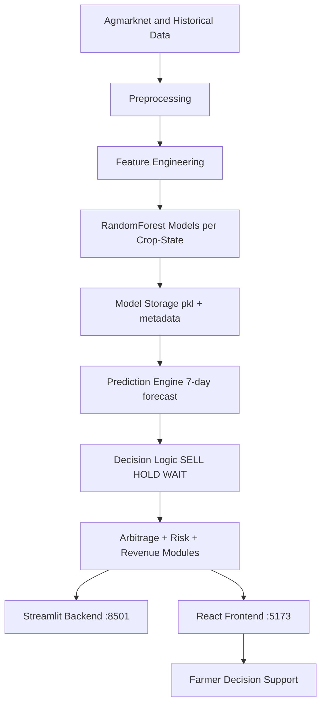

<div align="center">

# 🌾 AgroAI - The Smart Selling Advisor

<p align="center">
  <b>From मेहनत to Profit: AI-Powered Market Intelligence for Farmers</b>
</p>

[](https://react.dev/)
[](https://streamlit.io/)
[](https://scikit-learn.org/)
[](https://python.org/)
[](https://telegram.org/)
[](https://n8n.io/)
[]()
[]()

[**The Problem**](#-the-problem) • [**Our Solution**](#-our-solution) • [**Tech Stack**](#-tech-stack) • [**Features**](#-key-features) • [**Architecture**](#-end-to-end-architecture) • [**Business Model**](#-business-model) • [**Impact**](#-impact--scale)

</div>

---

## 🚨 The Problem

Indian farmers face price uncertainty at the most critical decision point: selling.

- 86% of farmers are small and marginal (<2 hectares), so small price drops cause high loss.
- Farm-gate volatility and mandi information gaps drive distress selling.
- Many farmers sell immediately after harvest when market supply is highest and prices are lowest.
- Most digital tools are English-heavy and hard to use for grassroots users.
- Farmers need decision intelligence, not just raw data.

Core questions AgroAI solves:

- When should I sell?
- Where should I sell for better realized profit?

---

## 💡 Our Solution
https://agroai-market.vercel.app

AgroAI is an AI Smart Selling Advisor that predicts short-term mandi prices and gives direct action signals.

- Predicts crop prices for upcoming days.
- Recommends SELL, HOLD, or WAIT.
- Compares nearby mandis to find better realized rates.
- Improves net outcomes using price plus transport-aware logic.
- Supports bilingual usage for inclusive adoption.

Outcome promise:

- Better selling timing.
- Better mandi selection.
- Better realized income per kg.

---

## 🧰 Tech Stack

<div align="center">

[](https://react.dev/)
[](https://vitejs.dev/)
[](https://streamlit.io/)
[](https://scikit-learn.org/)
[](https://python.org/)

[](https://telegram.org/)
[](https://n8n.io/)
[]()
[](https://openrouter.ai/)

</div>

- AI advisory flows are powered by an LLM-based GenAI layer.
- Telegram bot acts as a low-friction farmer access channel.
- n8n orchestrates chatbot workflows, triggers, and integration routing.

---

## 🚀 Key Features

### 1) Real-Time + Historical Intelligence
- Uses historical and recent mandi trend intelligence.
- Designed for high-frequency refresh workflow.
- Incorporates seasonality and trend behavior from market signals.

### 2) Local Mandi Price Prediction
- Crop-state specific forecasting.
- AI recommendation engine: SELL or HOLD or WAIT.
- Visual comparison of current and predicted prices.

### 3) Multilingual Accessibility
- Built for usability across language preferences.
- Frontend translation flow supports local-language experience.
- Low-friction interaction for small and marginal farmers.

### 4) Profit Optimization
- Multi-market arbitrage tracker for best selling location.
- Distance-aware comparison for practical decisions.
- Revenue calculator for quantity-based expected return.

---

## ✅ What AgroAI Can Do Today

- 7-day AI price prediction for crop-state combinations.
- Action recommendation engine with SELL or HOLD or WAIT output.
- Model performance dashboard with R2, MAE, RMSE, and data points.
- Multi-market arbitrage tracker with estimated extra ₹ per kg gain.
- Last 30-day trend chart and 7-day forecast chart.
- Volatility-based risk banding: HIGH or MEDIUM or LOW.
- Revenue estimation based on quantity and predicted price.
- React-to-Streamlit continuity with selected crop and state context.

---

## ⚙️ End-to-End Architecture



Technical highlights:

- Per-combination model loading from pkl artifacts.
- Metadata-based crop-state discovery.
- Cached inference workflow for speed.
- Interactive Plotly visual analytics.

---

## 🧠 USP Snapshot

- Predictive decision support instead of guesswork.
- Recommendation plus actionability, not just dashboarding.
- Bilingual and farmer-first interaction design.
- Built for both survival-margin and scale-margin use cases.

---

## 💼 Business Model

AgroAI follows a practical dual path.

### Farmer-Centric Freemium
- Easy entry through conversational assistant interfaces.
- Basic advisory at no onboarding friction.
- Upgrade path for advanced comparison and analytics.

### B2G2F Institutional Strategy
- Partnership model with government and institutional channels.
- Public-good access for farmers with sustainable platform revenue.
- Scope for advisory integration with larger agri ecosystems.

---

## 🏛 Government and Institutional Collaboration Scope

Potential alignment areas:

- Agriculture Infrastructure Fund (AIF)
- Digital Agriculture Mission (DAM)
- RKVY-RAFTAAR startup grant pathways
- State-level decision support and advisory deployments

---

## 📈 Impact and Scale

Target impact:

- Reduce distress selling via better sell-time decisions.
- Improve realized ₹ per kg through better mandi choice.
- Increase trust with explainable recommendations.
- Improve inclusion through local-language, simple UI workflows.

Pilot metrics to track:

- Average ₹ per kg gain versus local baseline mandi sale.
- Percent of users following AI recommendation.
- Repeat usage and seasonal retention.
- Reduction in low-price-day selling behavior.

---

## 🔮 Future Scope

- WhatsApp access layer for quick advisory and alerts.
- Website remains advanced analytics hub.
- WhatsApp layer handles lightweight queries and recommendation access.
- Expansion toward larger mandi and crop coverage with richer integrations.

---

## 🧪 Local Run Guide

### Backend

```bash
cd VIHAAN_DTU
.venv\Scripts\activate
streamlit run app.py
```

Open: http://localhost:8501

### Frontend

```bash
cd VIHAAN_DTU\Agrow-Ai\frontend\agroai-react
npm install
npm run dev -- --host localhost --port 5173
```

Open: http://localhost:5173

---

## 📁 Project Structure

```text
VIHAAN_DTU/
|-- app.py
|-- offline_train.py
|-- check_accuracy.py
|-- verify_cache.py
|-- requirements.txt
|-- assets/
|-- src/
|-- models/
|-- agmarknet-india-commodity-prices-2024-2025/
`-- Agrow-Ai/
    |-- AgroAIdemo/
    `-- frontend/
        `-- agroai-react/
```

---

## 📚 Reference Notes

Problem framing and strategy points in this README are aligned with your presentation deck themes, including:

- Farmer distress-selling context.
- Crop price decision intelligence.
- Mandi comparison and profitability focus.
- Accessibility-first product direction.

---

<div align="center">
  <b></b><br>
  <i>Data-Driven Agriculture. Inclusive by Design.</i>
</div>
